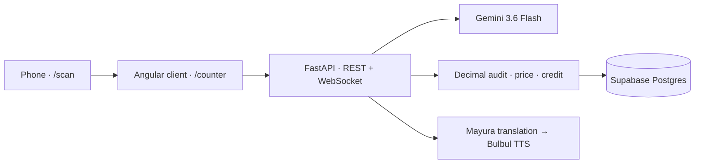

# ParchaPay AI

**A wholesale-bill audit demo for India's neighborhood merchants.** Scan a supplier parcha, verify its arithmetic, compare eligible local prices, and hear a Paytm Soundbox-style audit.

## The demo

- **Phone — `/scan`:** capture or upload a bill.
- **Counter — `/counter`:** review line-item findings, Mandi-Pulse, the Soundbox twin, and the 7-day QR split-credit preview. Opening `/` redirects here.
- **Audit:** Gemini 3.6 Flash extracts the bill; Python `Decimal` checks the math; supplier and pincode history are read from Supabase. Mandi-Pulse requires at least five distinct stores for the same SKU and pincode in the 14-day window.
- **Voice:** Mayura translates the deterministic alert; Bulbul v4 Flash synthesizes speech when Sarvam is configured. Values are checked before speech. A browser transcript fallback remains available.
- **Resolution:** the demo previews supplier reconciliation and simulates the split-credit flow. No payment or live GSTN write is performed.



## Run locally

Requires Docker Desktop. Copy `.env.example` to `.env`, fill the required backend settings, then run:

```bash
docker compose up --build
```

Open [http://localhost:4200](http://localhost:4200) for the counter, or [http://localhost:4200/scan](http://localhost:4200/scan) for the phone view. The local Compose stack serves Angular and FastAPI separately and proxies `/api`, `/static`, and `/ws` to the API.

| Setting | Purpose |
| --- | --- |
| `SUPABASE_URL`, `SUPABASE_SECRET_KEY` | Existing Supabase project (server-side only) |
| `PARCHA_DEMO_MERCHANT_ID` | Seeded merchant used for demo scans |
| `GEMINI_API_KEY` | Bill-image extraction |
| `SARVAM_API_KEY` | Optional translation and speech |
| `PARCHA_TRANSLATION_SOURCE_LANGUAGE` | Translation source, default `en-IN` |
| `PARCHA_TRANSLATION_TARGET_LANGUAGE`, `PARCHA_TTS_LANGUAGE` | Target and speech language; keep them matched (default `hi-IN`) |
| `PARCHA_TTS_SPEAKER` | Sarvam Bulbul v4 speaker persona |
| `PARCHA_DEMO_AUTH_ENABLED` | `false` locally; Render enables Basic Auth for protected POSTs |

## API surface

- `POST /api/parcha/scan` — extract, audit, and persist a scan
- `POST /api/parcha/{invoice_id}/resolve` — approve the 7-day split flow
- `GET /api/parcha/{invoice_id}/export?format=tally|marg` — export invoice data
- `POST /api/demo/load-sample` — load the golden demo fixture
- `/ws/counter` — counter lifecycle events; `/static` — crops and audio
- `GET /healthz` — deployment health check

## Render deployment

`render.yaml` and `render.Dockerfile` define a **single-origin Render Free** deployment: Angular is built for production and served by FastAPI, preserving the relative API and WebSocket URLs. Render credentials belong in its environment settings, not in Git. The Blueprint enables HTTP Basic Auth for scan, resolve, and sample POSTs; the browser asks for credentials on the first protected action.

Render Free services sleep after 15 minutes idle and can take about a minute to wake. Generated audio/crops are temporary and may be lost on sleep or restart. The UI, read-only APIs, and `/ws/counter` are not behind Basic Auth, so use synthetic demo data only. Gemini and Sarvam usage can incur separate provider charges.

## Checks

Run the backend suite through Docker:

```bash
docker compose run --rm --no-deps api python -m unittest discover -s tests -v
```

Avoid the live Sarvam smoke script during routine checks; it makes paid provider calls.
