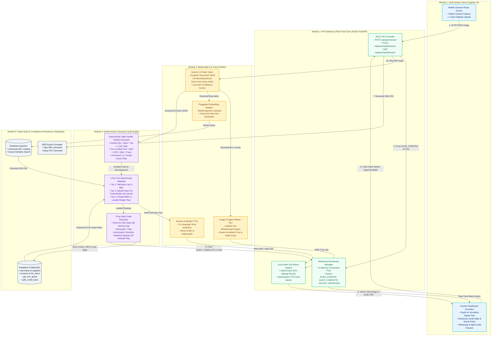

# Engineering Document (ED) — Part 1: High-Level Design (HLD) & Module Breakdown

## 1\. High-Level Architecture Diagram (Mermaid)

This diagram illustrates the end-to-end data flow across the two frontend surfaces, the FastAPI orchestration and WebSocket broadcast layer, the pluggable AI/Voice providers, the deterministic math engine, and Supabase storage.



&nbsp;

---

## 2\. High-Level Module Breakdown

### Module 1: Dual-Surface Client Module (Angular 19\)

Handles both the shopkeeper's mobile capture view and the countertop projection display inside a single Angular workspace using Standalone Components and Signals.

#### Key Sub-Components:

* **Mobile Scanner Route (`/scan`):** Lightweight mobile web view using native HTML5 camera capture (`capture="environment"`) to photograph paper parchas and upload `multipart/form-data` to FastAPI.  
* **Countertop Dashboard Route (`/counter`):** Split-screen desktop view designed for the projector.  
  * **Left Panel (Audit & Compliance Ledger):** Displays the uploaded bill with visual bounding boxes, the line-item audit table (red highlights for rate hikes/math errors, yellow highlights for \<80% OCR confidence), the Mandi-Pulse pin-code badge, and the GST IMS Shield status.  
  * **Right Panel (Paytm AI Soundbox Digital Twin):** Interactive hardware simulation featuring a Front Touchscreen Card (Red/Green summary), an automated HTML5 audio player that speaks the regional voice alert, and a clickable physical Paytm Button.  
* **Resolution Drawers:** Slide-out Supplier WhatsApp Simulator Drawer (displaying the polite reconciliation text, the cropped pen-edit photo, and a Paytm Payment Link) and the 7-Day Split-Credit Progress Bar.

---

### Module 2: API Gateway & Real-Time Sync Module (Python FastAPI)

Acts as the central nervous system connecting the mobile phone, the AI/audit backend, and the laptop projector screen with sub-second latency.

#### Key Functional Responsibilities:

* **REST Ingress & Action Endpoints:** Handles image upload (`POST /api/parcha/scan`), 1-tap resolution approval when the Paytm Button is pressed (`POST /api/parcha/{id}/resolve`), demo fallback seeding (`POST /api/demo/load-sample`), and ERP file downloads (`GET /api/parcha/{id}/export`).  
* **Native WebSocket Broadcaster (`/ws/counter`):** Maintains an active WebSocket connection with the `/counter` dashboard. The exact millisecond `/scan` begins uploading a photo, FastAPI broadcasts `{"event": "SCAN_STARTED"}` so the laptop screen immediately animates "Auditing Parcha..." before the AI finishes processing.  
* **Local Static Asset Server (`/static`):** Mounts a local directory via FastAPI `StaticFiles` to serve cropped pen-markup images (`/static/crops/{id}.jpg`) and synthesized voice alerts (`/static/audio/{id}.wav`) over local HTTP with zero cloud storage upload delay.  
* **Async Task Orchestrator:** Uses Python `asyncio.gather()` to run pgvector SKU lookups, historical SQL queries, image cropping, and TTS voice synthesis concurrently once VLM extraction completes.

---

### Module 3: Multimodal AI & Voice Pipeline Module

Isolates all external AI/ML model calls behind clean Python wrapper functions so providers or prompts can be tuned quickly on hackathon day.

#### Key Functional Responsibilities:

* **Structured Vision Extractor (Gemini 2.5 Flash):** Sends the raw bill image to Gemini 2.5 Flash with a strict Pydantic `response_schema`. Extracts supplier details, invoice metadata, line items (raw name, billed qty, free qty, MRP, rate, GST %), an OCR confidence score (0.0–1.0) per line, a boolean `has_pen_markup`, and normalized 2D coordinates `[ymin, xmin, ymax, xmax]` for any handwritten strikethrough.  
* **Visual Dispute Cropper (Pillow):** Takes the `[ymin, xmin, ymax, xmax]` coordinates from Gemini, adds a 15% visual padding margin so the context around the pen edit is clearly visible, crops the original image, and saves it to `/static/crops/`.  
* **Pluggable Embedding Adapter:** Exposes a simple `get_embedding(text: str) -> list[float]` wrapper (kept model-agnostic so you can drop in Gemini Embeddings, OpenAI, or a local fast embedder on sprint day) to convert noisy invoice item text into a vector for pgvector lookup.  
* **Regional Voice Synthesizer (Sarvam AI TTS):** Converts the structured discrepancy summary into natural Kannada, Hindi, or English speech (handling Indian rupee formatting like ₹13,860) and writes the audio stream to `/static/audio/`.

---

### Module 4: Deterministic Financial & Audit Engine Module

A pure Python (`decimal.Decimal`) rule engine—zero LLM involvement—guaranteeing 100% financial accuracy for rupee calculations, price benchmarking, and credit underwriting.

#### Key Functional Responsibilities:

* **Line-Item & Checksum Math Verifier:**  
  * Checks whether $\text{Billed Qty} \times \text{Rate} + \text{Tax} == \text{Printed Line Total}$.  
  * Checks whether the sum of all line items matches the printed/handwritten Grand Total.  
  * Computes the exact True Landed Cost per Unit: $$\text{TrueLandedUnitCost} = \frac{\text{NetLineAmount} + \text{GSTAmount}}{\text{BilledQty} + \text{FreeSchemeQty}}$$  
* **3-Tier Price Benchmark Waterfall:**  
  * **Tier 1 (Personal History):** Compares True Landed Unit Cost against the merchant's last 3 invoices for that Canonical SKU.  
  * **Tier 2 (Mandi-Pulse Pin-Code Benchmark):** Queries anonymized purchase records in the same pin code over the last 14 days. If $\geq 5$ distinct store records exist, computes the median price band and flags overcharges above the band. If $<5$ records exist, gracefully skips to Tier 1/Tier 3\.  
  * **Tier 3 (MRP Margin Floor):** Compares printed MRP against True Landed Cost and flags items where the retailer's gross margin falls below the category threshold ($< 8\%$).  
* **Split-Credit Underwriting & Amortization Engine:**  
  * Calculates the merchant's Max Daily Deduction Cap: $\text{Avg30-DayDailyQRVolume} \times 0.35$.  
  * Generates the 7-day daily QR settlement deduction schedule and attaches the fallback UPI Autopay / e-NACH Mandate status.

---

### Module 5: Hybrid Data & Compliance Persistence Module (Supabase)

Manages shared cloud state across PostgreSQL relational tables and pgvector embeddings so all 3 teammates can develop against the same live dataset.

#### Key Functional Responsibilities:

* **Vector Entity Resolution (pgvector):** Stores the master `canonical_skus` table with vector embeddings. Executes cosine similarity search (`<=>`) to map messy distributor strings ("HUL BRK BND RDLBL 250") to a single `canonical_sku_id`.  
* **Relational Financial Ledger (PostgreSQL):** Stores merchants, suppliers, invoices, `invoice_line_items` (including `expiry_date` for the 30-day Inward Expiry Radar), and `split_credit_loans`.  
* **GST IMS Staging Queue:** Stores and updates the compliance state (Unverified $\rightarrow$ Disputed\_Pending\_IMS or Accepted) alongside the cropped pen-markup proof URL so the merchant is protected before the 14th of the month.  
* **1-Click ERP Exporter:** Transforms verified invoice rows into downloadable Tally XML or Marg CSV files for semi-organized stores.

---

## Summary of How This Divides Cleanly Across 3 Developers

| Developer | Owned Modules | Primary Deliverables |
| :---- | :---- | :---- |
| **Dev 1 (Frontend)** | Module 1 | Angular `/scan` mobile view, `/counter` Soundbox Digital Twin UI, WebSocket listener, WhatsApp & Split-Credit drawers. |
| **Dev 2 (Backend & DB)** | Module 2 \+ Module 5 | FastAPI REST \+ WebSocket hub, `/static` file serving, Supabase Postgres \+ pgvector schema & seed script, Tally/Marg export. |
| **Dev 3 (AI & Audit Logic)** | Module 3 \+ Module 4 | Gemini 2.5 Flash structured prompt \+ bounding-box crop (Pillow), Sarvam TTS integration, and the Python Decimal Audit & Split-Credit engine. |

---

---

# Part 2: Core Interoperability Specification (CIS) — Unified System Schema & Contracts

This specification serves as the immutable data contract and integration standard for ParchaPay AI. All three developers and their respective AI coding agents (Cursor, Windsurf, Claude Code) must adhere strictly to the exact types, database columns, API routes, and WebSocket event payloads defined below. Deviations from these schemas will break end-to-end integration during the hackathon sprint.

---

## 1\. Monorepo Directory Layout & Ownership Boundaries

To eliminate Git merge conflicts during the 6.5-hour build, each developer owns an isolated directory subtree. Shared contracts are placed in a common schemas directory that is read-only after Hour 0.5.

```
parchapay-ai/
├── contracts/                        # Read-only shared definitions
│   ├── contracts.ts                  # TypeScript types for Angular (Dev 1)
│   ├── contracts.py                  # Pydantic models for FastAPI (Dev 2 & 3)
│   └── demo_bill_fixture.json        # Golden mock payload for mock-first testing
├── frontend/                         # DEV 1 TERRITORY (Angular 19)
│   ├── src/
│   │   ├── app/
│   │   │   ├── routes/
│   │   │   │   ├── scan/             # Mobile PWA camera capture view
│   │   │   │   └── counter/          # Soundbox Digital Twin + Projector Dashboard
│   │   │   ├── components/
│   │   │   │   ├── soundbox-twin/    # Dual-screen hardware simulation
│   │   │   │   ├── audit-table/      # Red/Green discrepancy & Mandi-Pulse table
│   │   │   │   ├── whatsapp-drawer/  # Slide-out reconciliation message simulation
│   │   │   │   └── split-credit/     # 7-day QR settlement amortization UI
│   │   │   └── services/
│   │   │       ├── websocket.service.ts
│   │   │       └── api.service.ts
├── backend/                          # DEV 2 & DEV 3 TERRITORY (FastAPI)
│   ├── app/
│   │   ├── api/                      # DEV 2: REST endpoints & WebSocket broadcaster
│   │   │   ├── scan_router.py
│   │   │   ├── resolve_router.py
│   │   │   └── export_router.py
│   │   ├── core/                     # DEV 2: Config, database client, static file serving
│   │   │   ├── config.py
│   │   │   ├── db.py
│   │   │   └── ws_manager.py
│   │   ├── engine/                   # DEV 3: Deterministic finance & benchmark logic
│   │   │   ├── math_engine.py        # Decimal-based True Landed Cost & Checksums
│   │   │   ├── waterfall_engine.py   # Self-history, Mandi-Pulse, MRP check
│   │   │   └── credit_engine.py      # 35% QR velocity cap & 7-day deduction
│   │   └── services/                 # DEV 3: AI & Media generation wrappers
│   │       ├── gemini_vision.py      # Gemini 2.5 Flash VLM client
│   │       ├── pillow_cropper.py     # Pen-markup bounding box cropper
│   │       ├── embedding_client.py   # Vectorizer adapter
│   │       └── sarvam_tts.py         # 11-language voice alert synthesizer
│   └── static/                       # Fast local asset storage
│       ├── crops/                    # Cropped pen-markup JPGs
│       └── audio/                    # Synthesized voice alert WAV/MP3s
└── supabase/                         # DEV 2 TERRITORY (Database & Migrations)
    └── migrations/
        ├── 001_initial_schema.sql    # DDL with pgvector extension
        └── 002_seed_demo_data.sql    # 1 Demo store + 5 nearby stores in Bellandur
```

---

## 2\. Supabase PostgreSQL & pgvector DDL Schema (`001_initial_schema.sql`)

This SQL script initializes the relational tables and the vector extension in Supabase. It handles foreign keys, status constraints, and an HNSW vector index for SKU resolution.

```sql
-- Enable pgvector extension
CREATE EXTENSION IF NOT EXISTS vector;

-- 1. Merchants Table
CREATE TABLE merchants (
    id UUID PRIMARY KEY DEFAULT gen_random_uuid(),
    business_name VARCHAR(255) NOT NULL,
    pincode VARCHAR(10) NOT NULL,              -- e.g., '560103' (Bellandur)
    phone VARCHAR(15) NOT NULL,
    upi_vpa VARCHAR(100) NOT NULL,
    avg_daily_qr_volume DECIMAL(12, 2) NOT NULL DEFAULT 10000.00,
    created_at TIMESTAMPTZ DEFAULT NOW()
);

-- 2. Suppliers Table
CREATE TABLE suppliers (
    id UUID PRIMARY KEY DEFAULT gen_random_uuid(),
    name VARCHAR(255) NOT NULL,
    gstin VARCHAR(15),
    phone VARCHAR(15),
    upi_vpa VARCHAR(100),
    created_at TIMESTAMPTZ DEFAULT NOW()
);

-- 3. Canonical SKUs Table (Vector Entity Resolution)

CREATE TABLE canonical_skus (
    id UUID PRIMARY KEY DEFAULT gen_random_uuid(),
    product_name VARCHAR(255) NOT NULL,        -- 'Fortune Sunlite Refined Sunflower Oil 1L'
    brand VARCHAR(100) NOT NULL,              -- 'Fortune'
    category VARCHAR(100) NOT NULL,           -- 'Edible Oil'
    standard_mrp DECIMAL(10, 2) NOT NULL,     -- 140.00
    embedding vector(768)           -- Standard 768-dim vector (Gemini Embeddings)
    aliases TEXT[], -- REQUIRED BY 002_seed_demo_data.sql 
    created_at TIMESTAMPTZ DEFAULT NOW()
);


CREATE INDEX idx_canonical_skus_embedding 
ON canonical_skus USING hnsw (embedding vector_cosine_ops);

-- 4. Invoices Table
CREATE TABLE invoices (
    id UUID PRIMARY KEY DEFAULT gen_random_uuid(),
    merchant_id UUID REFERENCES merchants(id) ON DELETE CASCADE,
    supplier_id UUID REFERENCES suppliers(id) ON DELETE SET NULL,
    invoice_number VARCHAR(100),
    invoice_date DATE DEFAULT CURRENT_DATE,
    raw_image_url TEXT,
    dispute_crop_url TEXT,
    audio_alert_url TEXT,
    billed_total DECIMAL(12, 2) NOT NULL,
    approved_total DECIMAL(12, 2) NOT NULL,
    overcharge_amount DECIMAL(12, 2) DEFAULT 0.00,
    status VARCHAR(50) NOT NULL DEFAULT 'AUDITED', -- 'AUDITED', 'DISPUTED_PENDING_IMS', 'SETTLED'
    created_at TIMESTAMPTZ DEFAULT NOW()
);

-- 5. Invoice Line Items Table
CREATE TABLE invoice_line_items (
    id UUID PRIMARY KEY DEFAULT gen_random_uuid(),
    invoice_id UUID REFERENCES invoices(id) ON DELETE CASCADE,
    canonical_sku_id UUID REFERENCES canonical_skus(id) ON DELETE SET NULL,
    raw_item_name VARCHAR(255) NOT NULL,       -- 'FORTUNE SUN 1L PO'
    printed_qty INT NOT NULL, -- Original quantity before pen edit (e.g., 12) 
    billed_qty INT NOT NULL,
    free_qty INT NOT NULL DEFAULT 0,
    billed_rate DECIMAL(10, 2) NOT NULL,
    tax_percent DECIMAL(5, 2) NOT NULL DEFAULT 5.00,
    true_landed_cost DECIMAL(10, 2) NOT NULL,  -- (LineTotal + Tax) / (Billed + Free)
    mrp DECIMAL(10, 2),
    expiry_date DATE, -- Used for 30-day Inward Expiry Radar (P1) 
    has_pen_markup BOOLEAN DEFAULT FALSE,
    ocr_confidence DECIMAL(4, 3) NOT NULL,     -- 0.000 to 1.000 (Flags yellow if < 0.800)
    bounding_box INT[],                        -- [ymin, xmin, ymax, xmax] normalized (0-1000)
    discrepancy_reason TEXT,                   -- 'RATE_HIKE', 'MATH_ERROR', 'SCHEME_MISSING'
    mandi_pulse_median DECIMAL(10, 2)          -- Anonymized pin code benchmark rate
);

-- 6. GST IMS Records Table
CREATE TABLE gst_ims_records (
    id UUID PRIMARY KEY DEFAULT gen_random_uuid(),
    invoice_id UUID REFERENCES invoices(id) ON DELETE CASCADE,
    gstin_supplier VARCHAR(15),
    invoice_number VARCHAR(100),
    ims_status VARCHAR(50) NOT NULL DEFAULT 'PENDING', -- 'PENDING', 'ACCEPTED', 'REJECTED'
    dispute_proof_url TEXT,
    auto_locked_deadline DATE,                 -- 14th of the month
    updated_at TIMESTAMPTZ DEFAULT NOW()
);

-- 7. Split Credit Loans Table
CREATE TABLE split_credit_loans (
    id UUID PRIMARY KEY DEFAULT gen_random_uuid(),
    invoice_id UUID REFERENCES invoices(id) ON DELETE CASCADE,
    merchant_id UUID REFERENCES merchants(id) ON DELETE CASCADE,
    principal_amount DECIMAL(12, 2) NOT NULL,
    daily_deduction_rate DECIMAL(10, 2) NOT NULL, -- Daily cut from QR sweep
    tenure_days INT NOT NULL DEFAULT 7,
    daily_cap_limit DECIMAL(10, 2) NOT NULL,   -- 35% of daily QR velocity
    autopay_mandate_active BOOLEAN DEFAULT TRUE,
    remaining_balance DECIMAL(12, 2) NOT NULL,
    status VARCHAR(50) NOT NULL DEFAULT 'ACTIVE', -- 'ACTIVE', 'COMPLETED', 'DEFAULTED'
    created_at TIMESTAMPTZ DEFAULT NOW()
);


--NEW FILE - 002_seed_demo_data.sql  
--This allows Dev 2 to seed Supabase instantly with the demo store and canonical items without worrying about vector generation APIs on Hour 0.5. 


-- Seed Demo Merchant in Bellandur (560103)
INSERT INTO merchants (id, business_name, pincode, phone, upi_vpa, avg_daily_qr_volume)
VALUES ('a0000000-0000-0000-0000-000000000001', 'Sharma General Store', '560103', '9876543210', 'sharma@paytm', 15000.00);

-- Seed Supplier
INSERT INTO suppliers (id, name, gstin, phone, upi_vpa)
VALUES ('b0000000-0000-0000-0000-000000000001', 'Sharmaji Wholesale Distributors', '29AABCU9603R1ZM', '9811122233', 'sharmaji-wholesale@paytm');

-- Seed Canonical SKUs with Text Aliases (Instant Fallback Lookup)
INSERT INTO canonical_skus (id, product_name, brand, category, standard_mrp, aliases)
VALUES 
('c0000000-0000-0000-0000-000000000001', 'Fortune Sunlite Refined Sunflower Oil 1L', 'Fortune', 'Edible Oil', 140.00, ARRAY['FORTUNE SUN 1L PO', 'FORTUNE OIL 1L', 'FORTUNE SUNFLOWER 1L']),
('c0000000-0000-0000-0000-000000000002', 'Parle-G Gold Biscuit Box (24pkts)', 'Parle', 'Snacks', 250.00, ARRAY['PARLE-G GOLD 100G', 'PARLE G 24PKT', 'PARLEG BISCUIT']);
-- Seed 1 Historical Invoice for Demo Merchant + 5 Anonymized Pin-Code Benchmark Rows for Fortune Oil 


INSERT INTO invoices (id, merchant_id, supplier_id, invoice_number, invoice_date, billed_total, approved_total, status)
VALUES ('d0000000-0000-0000-0000-000000000001', 'a0000000-0000-0000-0000-000000000001', 'b0000000-0000-0000-0000-000000000001', 'INV-2026-310', '2026-10-12', 1280.00, 1280.00, 'SETTLED');

INSERT INTO invoice_line_items (invoice_id, canonical_sku_id, raw_item_name, printed_qty, billed_qty, billed_rate, tax_percent, true_landed_cost, ocr_confidence)
VALUES 
('d0000000-0000-0000-0000-000000000001', 'c0000000-0000-0000-0000-000000000001', 'FORTUNE SUN 1L PO', 10, 10, 128.00, 5.00, 134.40, 0.99),
('d0000000-0000-0000-0000-000000000001', 'c0000000-0000-0000-0000-000000000001', 'FORTUNE OIL 1L', 10, 10, 127.00, 5.00, 133.35, 0.99),
('d0000000-0000-0000-0000-000000000001', 'c0000000-0000-0000-0000-000000000001', 'FORTUNE OIL 1L', 10, 10, 127.50, 5.00, 133.88, 0.99),
('d0000000-0000-0000-0000-000000000001', 'c0000000-0000-0000-0000-000000000001', 'FORTUNE OIL 1L', 10, 10, 128.00, 5.00, 134.40, 0.99),
('d0000000-0000-0000-0000-000000000001', 'c0000000-0000-0000-0000-000000000001', 'FORTUNE OIL 1L', 10, 10, 129.00, 5.00, 135.45, 0.99);


```

---

## 3\. Gemini 2.5 Flash Structured Vision Contract (`vision_schema.py`)

This strict Pydantic model must be passed directly into Gemini 2.5 Flash's `response_schema` parameter using the `google-genai` SDK. It enforces structured JSON output and normalizes bounding boxes without requiring secondary text parsing.

```py
from typing import List, Optional
from pydantic import BaseModel, Field

class BoundingBox2D(BaseModel):
    ymin: int = Field(..., ge=0, le=1000, description="Top-edge Y coordinate normalized to 0-1000")
    xmin: int = Field(..., ge=0, le=1000, description="Left-edge X coordinate normalized to 0-1000")
    ymax: int = Field(..., ge=0, le=1000, description="Bottom-edge Y coordinate normalized to 0-1000")
    xmax: int = Field(..., ge=0, le=1000, description="Right-edge X coordinate normalized to 0-1000")

class ExtractedLineItem(BaseModel):
    raw_item_name: str = Field(..., description="Verbatim item name or abbreviation from bill")
    billed_qty: int = Field(..., description="Billed quantity or handwritten adjusted quantity")
    free_qty: int = Field(0, description="Free or promotional scheme units")
    unit_rate: float = Field(..., description="Billed wholesale rate before tax")
    gst_percent: float = Field(5.0, description="GST slab percentage (e.g., 0, 5, 12, 18)")
    line_total: float = Field(..., description="Printed or written line total")
    mrp: Optional[float] = Field(None, description="Printed retail MRP if present on bill")
    has_pen_markup: bool = Field(False, description="True if delivery pen strikethrough is present")

   printed_qty: int = Field(..., description="Original printed quantity before any        handwritten pen edit (equals billed_qty if unedited)")


    pen_markup_box: Optional[BoundingBox2D] = Field(None, description="Bounding box around pen edit")
    confidence_score: float = Field(..., ge=0.0, le=1.0, description="OCR confidence for line item")

class RawExtractedInvoice(BaseModel):
    supplier_name: str = Field(..., description="Supplier or distributor business name")
    supplier_gstin: Optional[str] = Field(None, description="15-character GSTIN if printed")
    invoice_number: Optional[str] = Field(None, description="Invoice or Challan number")
    invoice_date: Optional[str] = Field(None, description="Date of the bill in YYYY-MM-DD")
    printed_grand_total: float = Field(..., description="Grand total printed or handwritten on bill")
    line_items: List[ExtractedLineItem] = Field(..., description="List of all extracted line items")
```

---

## 4\. Shared API & WebSocket Specifications

### REST Ingress Endpoints

| Method | Endpoint | Request Payload | Response Schema | Description |
| :---- | :---- | :---- | :---- | :---- |
| **POST** | `/api/parcha/scan` | `multipart/form-data`<br>`(file: image/pdf, merchant_id: uuid)` | `AuditedInvoiceResponse` | Triggers immediate `SCAN_STARTED` on WebSocket, executes pipeline, returns audited payload. |
| **POST** | `/api/parcha/{id}/resolve` | **JSON:**<br>`{"action": "APPROVE_SPLIT", "tenure_days": 7}` | `ResolveActionResponse` | Triggers WhatsApp message, updates GST IMS status, creates loan schedule. |
| **GET** | `/api/parcha/{id}/export` | **Query:**<br>`format=tally` or `format=marg` | File Download<br>*(.xml or .csv)* | 1-Click purchase voucher export for desktop accounting. |
| **POST** | `/api/demo/load-sample` | **JSON:**<br>`{"sample_id": "sample_pen_edit_01"}` | `AuditedInvoiceResponse` | Fail-safe demo trigger returning seeded golden response. |

---

### WebSocket Real-Time Events (`/ws/counter`)

The `/counter` dashboard maintains a persistent connection to this endpoint. FastAPI broadcasts three distinct events during the lifecycle:

#### Event 1: `SCAN_STARTED` *(Triggered within \<0.5s of image upload)*

```json
{
  "event": "SCAN_STARTED",
  "data": {
    "session_id": "sess_8f2b1a9c",
    "timestamp": "2026-10-30T10:14:22.105Z",
    "status": "PROCESSING_IMAGE",
    "message": "Auditing supplier parcha via Gemini 2.5 Flash..."
  }
}
```

#### Event 2: `AUDIT_COMPLETE` *(Triggered within \<3.5s with full payload)*

```json
{
  "event": "AUDIT_COMPLETE",
  "data": {
    "invoice_id": "b3e94a82-7d21-4f11-9a1b-9f4a13e2f109",
    "supplier_name": "Sharmaji Wholesale Distributors",
    "invoice_number": "INV-2026-402",
    "billed_total": 14000.00,
    "approved_total": 13860.00,
    "overcharge_amount": 140.00,
    "audio_alert_url": "/static/audio/alert_b3e94a82.wav",
    "dispute_crop_url": "/static/crops/pen_edit_b3e94a82.jpg",
    "voice_transcript": "Sharmaji bill checked. Oil rate up by Rs 6, pen math error of Rs 140. Pay Rs 13,860.",
    "items": [
      {
        "item_name": "Fortune Sunlite Sunflower Oil 1L",
        "billed_qty": 10,
        "printed_qty": 12,
        "free_qty": 0,
        "billed_rate": 134.00,
        "tax_percent": 5.0,
        "true_landed_cost": 140.70,
        "ocr_confidence": 0.94,
        "has_pen_markup": true,
        "discrepancy_type": "RATE_HIKE_AND_PEN_ERROR",
        "personal_history_rate": 128.00,
        "mandi_pulse_median": 127.50,
        "mandi_pulse_band": "₹126 - ₹129",
        "rate_status": "FLAGGED_HIGH"
      },
      {
        "item_name": "Parle-G Gold 100g Box (24pkts)",
        "billed_qty": 5,
        "printed_qty": 5,
        "free_qty": 1,
        "billed_rate": 240.00,
        "tax_percent": 5.0,
        "true_landed_cost": 210.00,
        "ocr_confidence": 0.76,
        "has_pen_markup": false,
        "discrepancy_type": "LOW_CONFIDENCE_REVIEW",
        "personal_history_rate": 240.00,
        "mandi_pulse_median": 240.00,
        "mandi_pulse_band": "₹238 - ₹242",
        "rate_status": "OK"
      }
    ],
    "gst_ims_shield": {
      "status": "SHIELD_READY",
      "flag_reason": "Quantity pen-corrected from 12 to 10; pending debit adjustment",
      "deadline": "2026-11-14"
    },
    "split_credit_pre_approval": {
      "is_eligible": true,
      "max_credit_limit": 24500.00,
      "daily_deduction_amount": 1980.00,
      "tenure_days": 7,
      "daily_velocity_cap": 3500.00,
      "autopay_mandate_registered": true
    }
  }
}
```

Event 3: `PAYOUT_APPROVED` *(Triggered upon pressing the Paytm Button)*

```json
{
  "event": "PAYOUT_APPROVED",
  "data": {
    "invoice_id": "b3e94a82-7d21-4f11-9a1b-9f4a13e2f109",
    "settlement_method": "SOUNDBOX_7_DAY_SPLIT",
    "whatsapp_claim": {
      "distributor_phone": "+919876543210",
      "message_preview": "Namaste Sharmaji Wholesale. Delivery received for Inv #INV-2026-402. Note: 2 units Fortune Oil pen-corrected. Amount approved: ₹13,860. [View Verified Challan Crop & Collect via Paytm Link]",
      "status": "SENT"
    },
    "gst_ims_state": "DISPUTED_PENDING_IMS",
    "loan_schedule": {
      "principal": 13860.00,
      "daily_deduction": 1980.00,
      "day_1_deducted": true,
      "remaining_balance": 11880.00
    }
  }
}
```

---

## 5\. Mock Golden Fixture (`demo_bill_fixture.json`)

To enable Mock-First Development, Dev 2 will configure `/api/parcha/scan` to immediately return this static fixture on Hour 0\. Dev 1 (Frontend) will build the entire UI, animations, audio player, and button triggers against this payload without waiting for live AI inference.

```json
{
  "invoice_id": "demo-golden-fixture-001",
  "supplier_name": "Sharmaji Wholesale Distributors",
  "supplier_gstin": "29AABCU9603R1ZM",
  "invoice_number": "INV-2026-402",
  "invoice_date": "2026-10-30",
  "billed_total": 14000.00,
  "approved_total": 13860.00,
  "overcharge_amount": 140.00,
  "audio_alert_url": "/static/audio/demo_alert.wav",
  "dispute_crop_url": "/static/crops/demo_pen_edit.jpg",
  "voice_transcript": "Sharmaji bill checked. Oil rate up by Rs 6, pen math error of Rs 140. Pay Rs 13,860.",
  "items": [
    {
      "item_name": "Fortune Sunlite Sunflower Oil 1L",
      "billed_qty": 10,
      "printed_qty": 12,
      "free_qty": 0,
      "billed_rate": 134.00,
      "tax_percent": 5.0,
      "true_landed_cost": 140.70,
      "ocr_confidence": 0.94,
      "has_pen_markup": true,
      "discrepancy_type": "RATE_HIKE_AND_PEN_ERROR",
      "personal_history_rate": 128.00,
      "mandi_pulse_median": 127.50,
      "mandi_pulse_band": "₹126 - ₹129",
      "rate_status": "FLAGGED_HIGH"
    },
    {
      "item_name": "Parle-G Gold 100g Box (24pkts)",
      "billed_qty": 5,
      "printed_qty": 5,
      "free_qty": 1,
      "billed_rate": 240.00,
      "tax_percent": 5.0,
      "true_landed_cost": 210.00,
      "ocr_confidence": 0.76,
      "has_pen_markup": false,
      "discrepancy_type": "LOW_CONFIDENCE_REVIEW",
      "personal_history_rate": 240.00,
      "mandi_pulse_median": 240.00,
      "mandi_pulse_band": "₹238 - ₹242",
      "rate_status": "OK"
    }
  ],
  "gst_ims_shield": {
    "status": "SHIELD_READY",
    "flag_reason": "Quantity pen-corrected from 12 to 10; pending debit adjustment",
    "deadline": "2026-11-14"
  },
  "split_credit_pre_approval": {
    "is_eligible": true,
    "max_credit_limit": 24500.00,
    "daily_deduction_amount": 1980.00,
    "tenure_days": 7,
    "daily_velocity_cap": 3500.00,
    "autopay_mandate_registered": true
  }
}
```

&nbsp;

&nbsp;

## 6\. Mobile Camera & Local Proxy Configuration

&nbsp;

6.1 Mobile Camera Hardware Constraint (/scan)&nbsp;

- &nbsp;Zero WebRTC Streams: Do NOT implement \`navigator.mediaDevices.getUserMedia\` or live video canvas streams. Modern mobile browsers block video streaming APIs on insecure \`http\://\` origins (such as local IP access over Wi-Fi).&nbsp;  
- Native OS Camera Intent:  Use a hidden HTML5 file input with \`capture="environment"\` and \`accept="image/\*"\`. This natively launches the mobile operating system's rear camera app even over unencrypted local networks (\`http\://192.168.x.x:4200\`) without throwing security exceptions.&nbsp;

6.2 Angular Reverse Proxy Configuration (\`frontend/proxy.conf.json\`)&nbsp;

- To avoid CORS issues and resolve relative URLs (such as \`/static/crops/...\` and \`/static/audio/...\`) identically across both mobile and desktop environments, all backend traffic must be proxied through port \`4200\`.&nbsp;

```json
- `/api` requests proxy to `http://localhost:8000`
- `/static` requests proxy to `http://localhost:8000` 
- `/ws` WebSocket connections proxy to `ws://localhost:8000` with WebSocket upgrading enabled
```

&nbsp;

&nbsp;

&nbsp;

&nbsp;